<p align="center">
  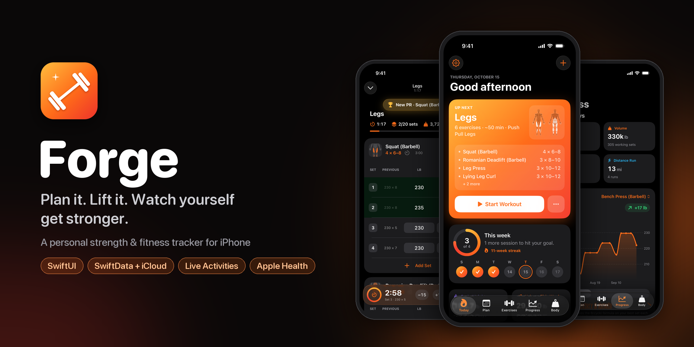
</p>

<p align="center">
  
  
  
  
  
</p>

**Forge** is a personal strength and fitness tracker for iPhone. I built it for my own training: you set up a split, log each set in the gym, and see whether you're getting stronger. It's native SwiftUI with no third-party packages. Data syncs through iCloud, and it connects to Apple Health, the Lock Screen and the Home Screen.

<table>
  <tr>
    <td align="center">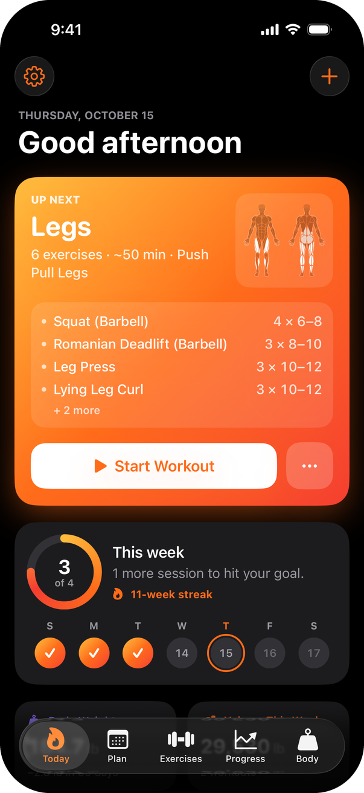<br><sub><b>Today</b></sub></td>
    <td align="center">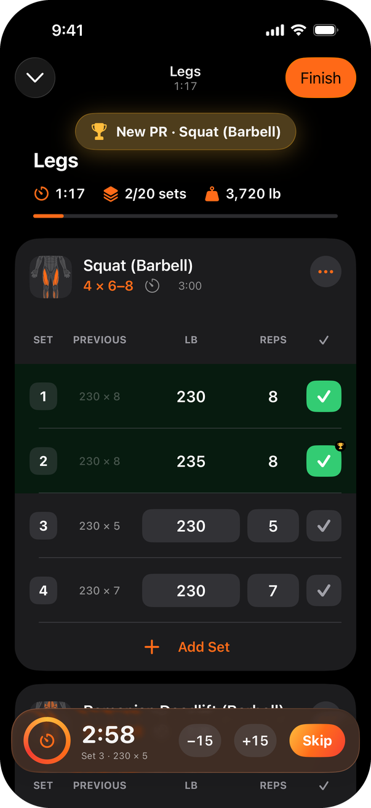<br><sub><b>Logging</b></sub></td>
    <td align="center">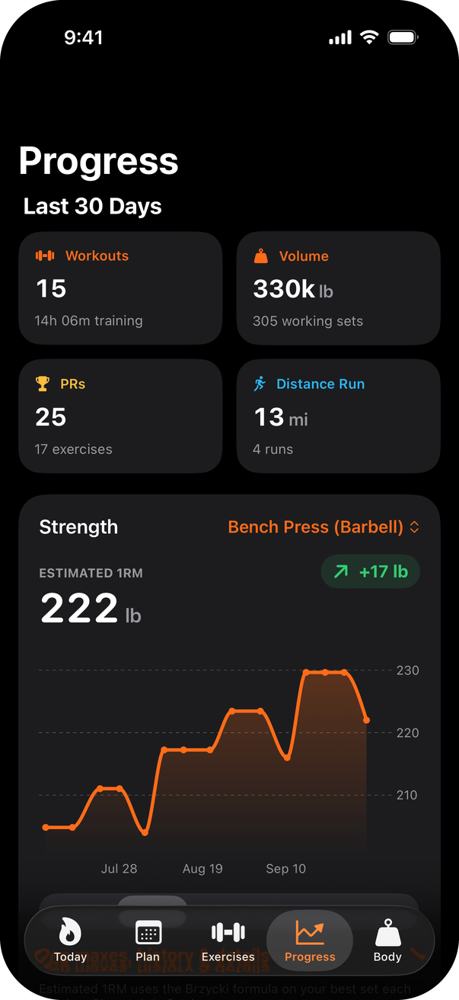<br><sub><b>Progress</b></sub></td>
    <td align="center">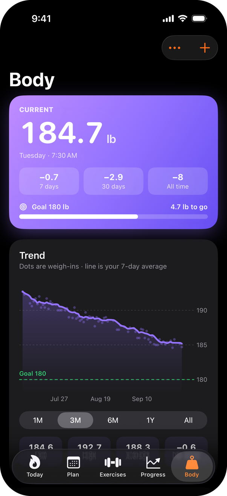<br><sub><b>Body</b></sub></td>
  </tr>
</table>

## Contents

- [Features](#features)
  - [Today](#today)
  - [Training splits](#training-splits)
  - [Exercise library and body map](#exercise-library-and-body-map)
  - [Live workout logging](#live-workout-logging)
  - [Progress and analytics](#progress-and-analytics)
  - [Body tracking](#body-tracking)
  - [Widgets and Live Activity](#widgets-and-live-activity)
  - [Apple Health and iCloud](#apple-health-and-icloud)
- [How it's built](#how-its-built)
- [Running it](#running-it)
- [Credits](#credits)

## Features

### Today

The home tab answers "what am I doing today?" It shows the next workout from your active split, a weekly goal ring with your streak, body weight and weekly volume at a glance, recent personal records and recent workouts.

<table>
  <tr>
    <td align="center"></td>
    <td align="center">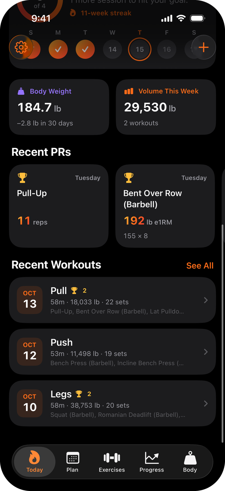</td>
    <td align="center">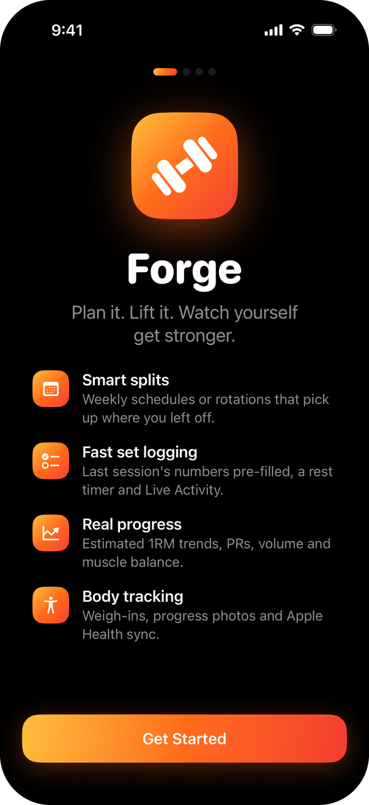</td>
  </tr>
</table>

### Training splits

A split can be scheduled two ways:

- **Weekly.** Each workout is pinned to days of the week, for example Upper A on Monday and a Long Run on Saturday.
- **Rotation.** Workouts repeat in order (Push, Pull, Legs, repeat). The rotation only moves on when you finish a day, so a missed day never throws the plan off. Rest slots in a rotation pass on their own after a day off.

Each day lists exercises with sets, a rep range (or seconds for holds), rest time and notes. A day can also be a cardio day, or end with a run finisher. You can start from one of four templates: Push Pull Legs, Upper / Lower, Full Body 3×, or a Bro Split.

<table>
  <tr>
    <td align="center">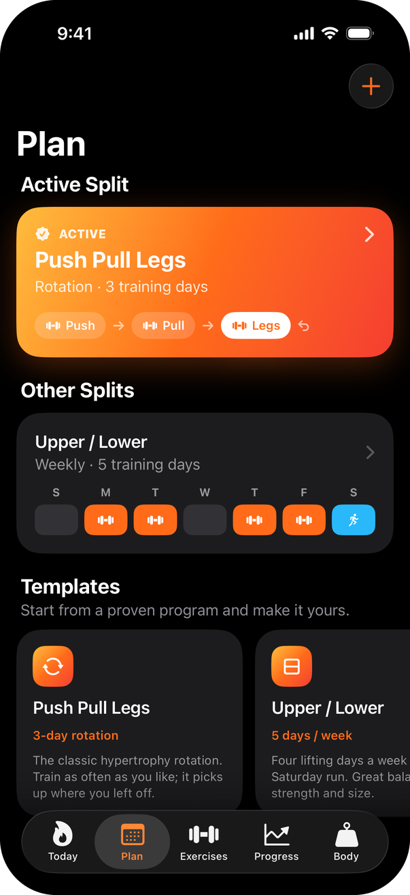</td>
    <td align="center">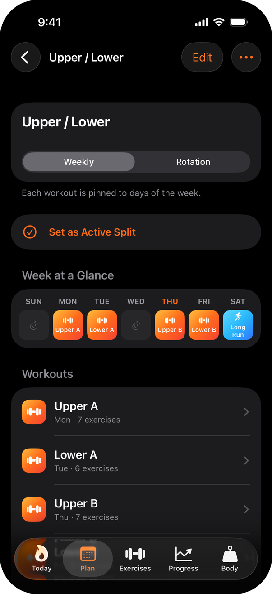</td>
    <td align="center">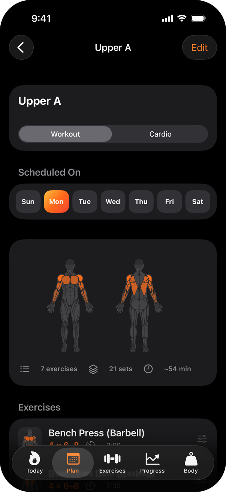</td>
  </tr>
</table>

### Exercise library and body map

- **903 exercises.** The [free-exercise-db](https://github.com/yuhonas/free-exercise-db) dataset, plus about 25 modern staples it was missing (Bulgarian split squat, cable lateral raise, pendulum squat and so on). Around 140 popular lifts have clean names and search aliases ("RDL", "OHP"), so "bench" finds *Bench Press (Barbell)* first.
- **Anatomical body map.** Every exercise highlights its primary and secondary muscles on a front/back figure, drawn natively with Canvas from vector paths. List thumbnails zoom in on the muscles each exercise works.
- **Custom exercises.** Tap muscles on the figure to tag them.
- **Exercise pages.** Each shows your estimated 1RM trend, a rep-max table, full history and form instructions.

<table>
  <tr>
    <td align="center">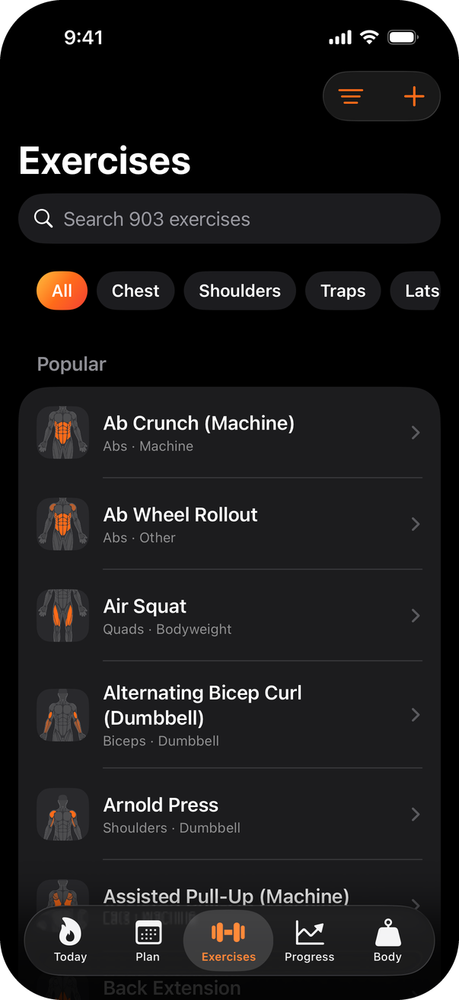</td>
    <td align="center">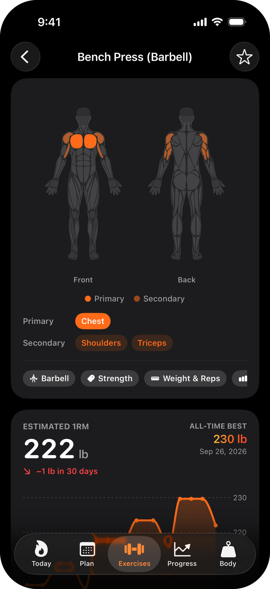</td>
    <td align="center">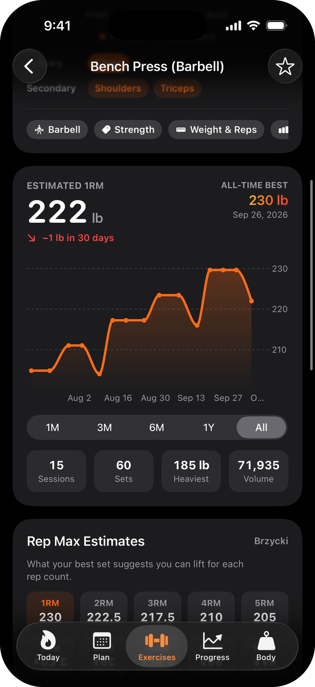</td>
  </tr>
</table>

### Live workout logging

The logger is built to be fast between sets:

- **Prefilled sets.** Each set starts with last session's numbers, shown next to it in a *Previous* column.
- **Progressive overload hints.** When you hit the top of the rep range on every set, Forge suggests going up in weight next time.
- **Custom entry bar.** −/+ steps (5 lb or 1 rep), Next and Done, so you rarely type.
- **Rest timer.** It starts when you complete a set, can be adjusted ±15 s, and sends a notification if your phone is in your pocket.
- **PR detection.** A banner and a trophy appear on the set as soon as you beat your best estimated 1RM, rep count or hold time.
- **Extras.** Warm-up sets, a plate calculator, cardio finishers, and minimizing the workout to keep browsing the app.
- **Summary.** Finishing shows duration, volume, PRs and the muscles you worked, plus confetti when you hit a PR.

<table>
  <tr>
    <td align="center"></td>
    <td align="center">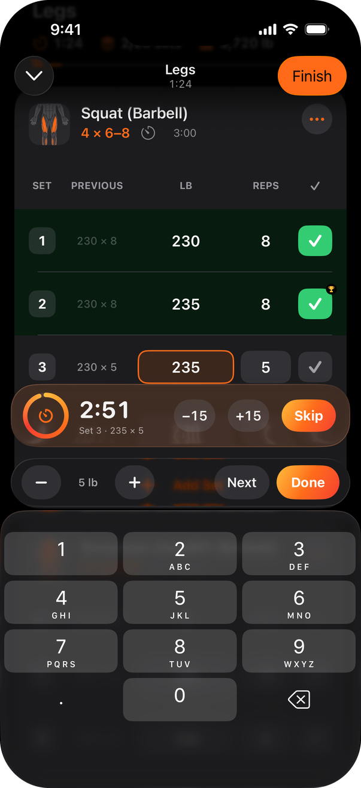</td>
    <td align="center">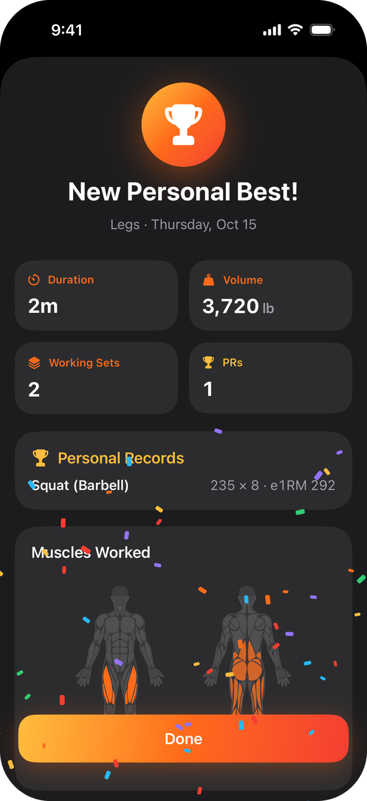</td>
  </tr>
</table>

### Progress and analytics

- **Estimated one-rep max** for every lift, using Brzycki by default (Epley, Blended or Lombardi in Settings). For example, 185 lb × 6 comes out at about 215 lb. Sets over 20 reps are left out of 1RM estimates.
- **Weekly training frequency** against your goal, and **weekly volume**.
- **Muscle balance.** Working sets per week for each muscle, drawn as a heatmap on the body and as bars against the 10–20 sets/week growth range.
- **Consistency grid**, weekly streak, running stats, personal records, and an editable workout history with a calendar.

<table>
  <tr>
    <td align="center"></td>
    <td align="center">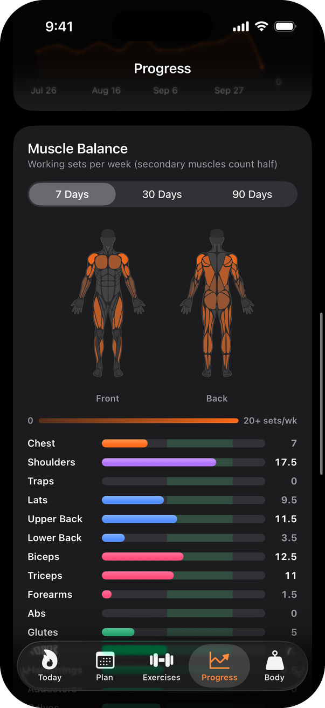</td>
    <td align="center">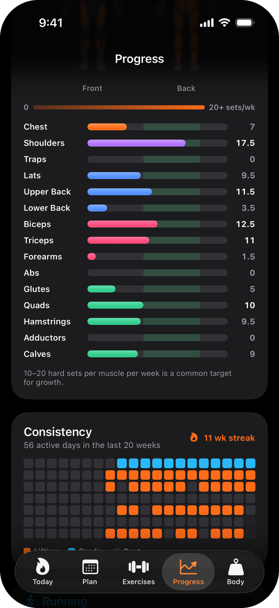</td>
  </tr>
</table>

### Body tracking

Body tracking covers weigh-ins with an optional body fat %, notes and progress photos (from the camera or library). The trend chart shows each weigh-in plus a 7-day average, with a goal line and weekly rate of change. A before/after slider compares progress photos.

<p align="center">
  
</p>

### Widgets and Live Activity

- **Live Activity.** During a workout, the Lock Screen and Dynamic Island show the elapsed time, the next set and a rest countdown.
- **Up Next widget** (small and medium). The next workout from your split, with its muscle map.
- **This Week widget** (small and Lock Screen circular). Sessions against your weekly goal, plus your streak.

<table>
  <tr>
    <td align="center">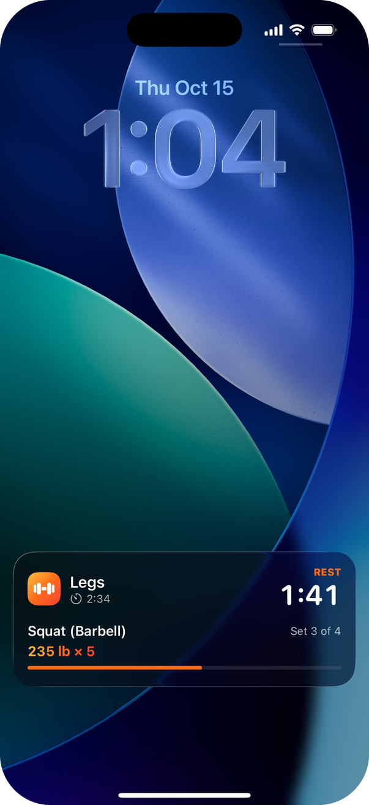</td>
    <td align="center">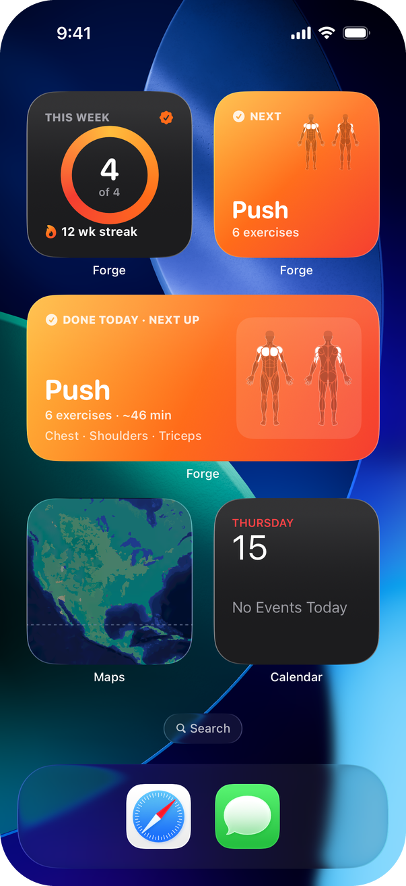</td>
  </tr>
</table>

### Apple Health and iCloud

- **Apple Health.** Forge imports weigh-ins (for example from a smart scale), and saves weigh-ins, strength workouts and runs with distance. Calories are estimated.
- **iCloud.** All data lives in SwiftData and syncs through your private CloudKit database. If iCloud isn't available, it falls back to a local store.
- **CSV export** of workouts, runs and weigh-ins.

## How it's built

| Layer | What it uses |
| --- | --- |
| UI | SwiftUI on iOS 26, with Liquid Glass, the tab bar bottom accessory and Swift Charts |
| Data | SwiftData models designed for CloudKit sync (every property has a default, relationships are optional, nothing is marked unique) |
| Body map | Vector paths normalized to plain `M/L/C/Q/Z` commands, parsed into SwiftUI `Path`s and drawn with `Canvas` |
| System | ActivityKit (Live Activity), WidgetKit (widgets via an App Group), HealthKit, UserNotifications |
| Tests | Swift Testing: 1RM math, rotation and rest-day rules, plate math, catalog integrity, widget timelines |

Some design decisions:

- **The exercise catalog is bundled JSON, not database rows.** Each device would otherwise seed its own 900 rows and CloudKit would sync duplicates. Only custom exercises and favorites are SwiftData models.
- **Workouts snapshot exercise names and muscles.** History still reads correctly if a custom exercise is renamed or deleted.
- **Analytics read a value-type `HistorySnapshot`.** It's rebuilt after each save, so charts never walk SwiftData relationships while rendering.
- **Scheduling is pure functions** (`ScheduleEngine`), so the rest-day rules are covered by unit tests.

For more detail, including the data model, scheduling rules, 1RM math, PR detection, how the widgets get their data, and the dataset pipeline, see [docs/ARCHITECTURE.md](docs/ARCHITECTURE.md).

```
Forge/            App target
  App/            Entry point, root tab view, settings keys
  Models/         SwiftData models, enums, exercise catalog/library
  Services/       Workout session, scheduling, PRs, 1RM, Health, history, widgets, sample data
  BodyMap/        Body map loader, path parser and views
  Design/         Theme, reusable components, formatters
  Features/       Today, Plan, Exercises, Workout, Cardio, Progress, Body, Settings, Onboarding
  Resources/      exercises.json, bodymap.json (generated, see scripts/)
ForgeWidgets/     Widget extension: Live Activity, Up Next, This Week
Shared/           Types shared by the app and the extension
ForgeTests/       Unit tests
Config/           Entitlements and Info.plist fragments
scripts/          Dataset pipeline, app icon and README image generators
docs/             Architecture notes and screenshots
```

## Running it

You need **Xcode 26.1 or later** (developed with Xcode 27) and a device or simulator running **iOS 26.1+**.

1. Clone the repo and open `Forge.xcodeproj`.
2. To run on a device, select the **Forge** and **ForgeWidgetsExtension** targets, then on **Signing & Capabilities** choose your team. If you're not me, also change the bundle identifiers, the iCloud container and the App Group from `com.kellamadams.forge` to your own.
3. Run (⌘R). On first launch, onboarding offers a starting split.

To explore with realistic data, use **Settings → Load Sample Data**, or add the launch argument `-seedDemoData` (it adds 12 weeks of workouts, runs and weigh-ins). **Settings → Erase All Data** removes it. Run the tests with **Product → Test** (⌘U).

> In the simulator, iCloud sync and HealthKit need a signed build and a signed-in Apple ID. Everything else works unsigned.

## Credits

- Exercise data: [free-exercise-db](https://github.com/yuhonas/free-exercise-db) by yuhonas (public domain, Unlicense).
- Body map artwork: [react-native-body-highlighter](https://github.com/HichamELBSI/react-native-body-highlighter) by ELABBASSI Hicham, MIT License. See [THIRD_PARTY_NOTICES.md](THIRD_PARTY_NOTICES.md).
