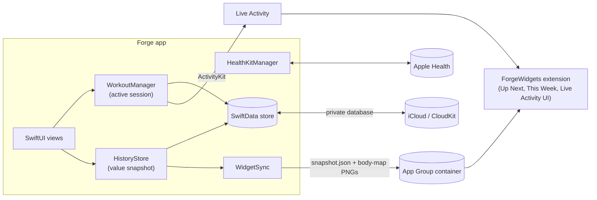
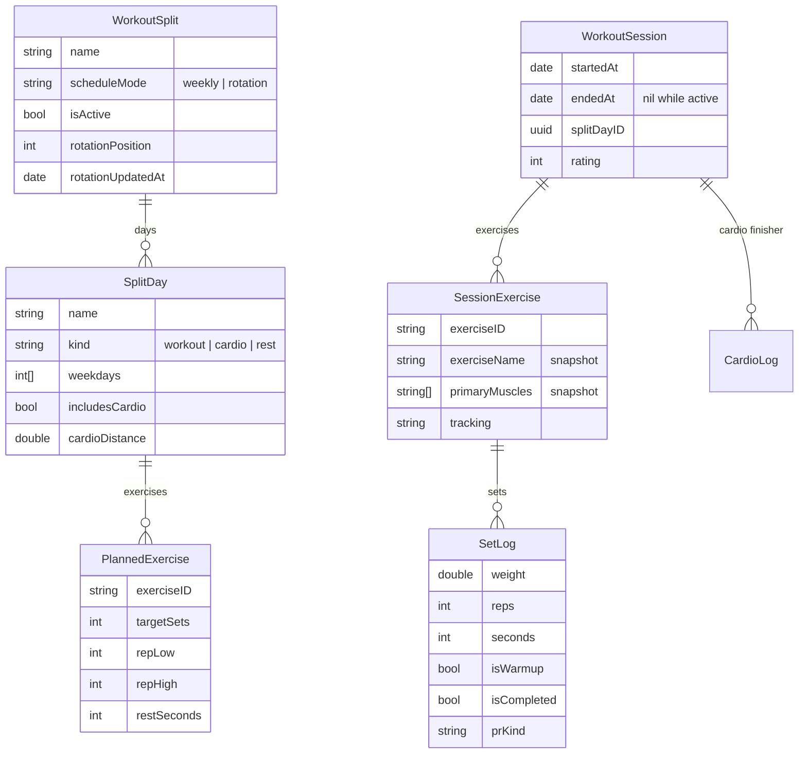

# Architecture

This document covers how Forge works under the hood. For features and screenshots, see the [README](../README.md).

## Overview



The app has three targets:

| Target | Role |
| --- | --- |
| `Forge` | The app. |
| `ForgeWidgetsExtension` | Draws the Live Activity, plus the *Up Next* and *This Week* widgets. |
| `ForgeTests` | Unit tests, written with Swift Testing. |

`Shared/` is compiled into both the app and the extension. It holds the ActivityKit attributes and the widget snapshot format.

## Data model

All persistent data is SwiftData, set up to sync through CloudKit. CloudKit adds rules SwiftData doesn't enforce on its own:

- every attribute has a default value,
- every relationship is optional and has an explicit inverse,
- nothing is marked unique,
- enums are stored as raw strings, and arrays get an `order` field because relationships are unordered.



`BodyWeightEntry` (stores the photo as external data), `CustomExercise` and `FavoriteExercise` are standalone models.

**Why the catalog isn't in SwiftData.** The 903 built-in exercises ship as `Resources/exercises.json` and are loaded once into `ExerciseCatalog`. If they were seeded as rows, every device would insert its own copy and CloudKit would sync the duplicates. `ExerciseLibrary` merges the catalog with custom exercises and handles search ranking. Exact name matches, prefix matches, aliases, popular lifts, favorites and custom exercises all raise the score.

**Why sessions snapshot names and muscles.** A `SessionExercise` copies the exercise's name, muscles and tracking type when it's created. History, analytics and PRs then keep working even if a custom exercise is later renamed or deleted.

## Scheduling

`ScheduleEngine` is a set of pure functions over plain values, so the rules are unit tested in `ForgeTests`.

**Weekly splits.** Each `SplitDay` has a list of weekdays. Today shows everything scheduled on the current weekday. If nothing is, the app finds the next scheduled day and shows it as a rest day with "next up".

**Rotation splits.** The split stores `rotationPosition` and `rotationUpdatedAt`. Finishing a workout from slot *i* moves the position to *i + 1* and records the time. The rotation never moves just because a calendar day passed, with one exception:

> **Rest slots are used up by calendar days.** Every full day between the last advance and today counts as one rest slot.

With a `Push → Pull → Legs → Rest` rotation where Legs is finished on Monday:

| Day | What Today shows |
| --- | --- |
| Monday (after Legs) | Done for today. Next up: Rest. |
| Tuesday | Rest day. Next: Push. |
| Wednesday | Push (the rest slot was used up on Tuesday). |
| Saturday | Still Push. Missed days never skip workouts. |

You can also skip a slot, or long-press a day to make it next. Both just set the position.

## Strength math

### Estimated one-rep max

`OneRepMax.estimate(weight:reps:formula:)` supports four formulas. Brzycki is the default.

| Formula | Equation | 185 lb × 6 |
| --- | --- | --- |
| Brzycki | w × 36 / (37 − r) | **214.8 lb** |
| Epley | w × (1 + r / 30) | 222.0 lb |
| Blended | average of Epley and Brzycki | 218.4 lb |
| Lombardi | w × r^0.10 | 221.3 lb |

A single rep returns the weight itself. Sets over 20 reps return `nil`. The rep-max table runs each formula backwards (`weight(forReps:)`). A round-trip test makes sure the inverse matches the forward formula.

### Personal records

Each exercise is tracked by one metric:

| Tracking type | PR metric |
| --- | --- |
| weight × reps | estimated 1RM |
| bodyweight | reps in a set |
| timed hold | seconds |

When a workout starts, `WorkoutManager` loads a baseline for each exercise: the best metric across all *finished* sessions. Every time a set is completed or edited, `PRService.evaluate` flags only the single best set in this session, and only if it beats the baseline. The first time you ever do an exercise, no PR is flagged, since there's nothing to beat. After history edits or deletes, `PRService.recomputeAll` replays every session in date order.

### Progressive overload hint

If every working set last time reached the top of the rep range, the new session's sets are prefilled at `last weight + increment` (5 lb by default) and the bottom of the range. A hint on the exercise explains why.

## The active workout

`WorkoutManager` is the one source of truth for the session in progress:

- **Persistence.** A session with `endedAt == nil` is saved like any other model, so a workout in progress survives the app being killed. The rest timer's end time goes into `UserDefaults`.
- **Prefill.** Sets are copied from the most recent finished session of the same exercise. Those values also drive the *Previous* column.
- **Rest timer.** When a set is completed, it starts the exercise's rest period. A local notification is scheduled for the end time, and a `Task` fires a haptic if the app is in the foreground. The caption under the countdown is computed from the next set's current values, so editing the weight while resting updates it.
- **Live Activity.** It starts with the workout, and updates when a set is completed, a set field loses focus, the rest timer changes, or exercises are added. It ends on finish or discard. Countdown and elapsed time use `Text(timerInterval:)`, so the system animates them without the app running.
- **Finish.** Unfinished sets are dropped, the rotation moves forward, the workout is saved to Health (if enabled), and the summary sheet is shown.

## Analytics and history

Charts that walked SwiftData relationships while rendering would fault thousands of objects on every frame. Instead, `HistoryStore` builds an immutable `HistorySnapshot` (sessions, exercises, sets and cardio as structs). Today, Progress and the widgets all read from that snapshot.

`DataVersion` watches `ModelContext.didSave`, and the root view rebuilds the snapshot whenever the save count or the 1RM formula changes. Rebuilds are skipped while a workout is running, because history can't change until it finishes.

The snapshot provides weekly buckets (workouts, volume, miles), weighted muscle sets (primary = 1, secondary = 0.5), training days for the consistency grid, the weekly streak (the current week only counts once it meets the goal), records, and per-exercise trends.

## Widgets

Widget extensions can't open the app's CloudKit-backed SwiftData store. After each history rebuild, `WidgetSync` writes a small `WidgetSnapshot` JSON file to the App Group container (`group.com.kellamadams.forge`).

- **Precomputed timeline.** The snapshot holds today's state plus one entry for each of the next seven midnights, computed by running `SplitService.todayPlan` forward and assuming no new training. Rest days and week rollovers update without the app running.
- **Pre-rendered body maps.** The Up Next widget's body map is rendered by the app as a PNG in the group container, since the extension doesn't bundle the path data. Old PNGs are removed.
- **Reloads only on change.** `WidgetCenter.reloadAllTimelines()` is called only when the snapshot or images actually changed.

## Body map pipeline

The figure art comes from [react-native-body-highlighter](https://github.com/HichamELBSI/react-native-body-highlighter) (MIT). Its SVG paths use compact relative syntax, including packed arc flags such as `a1.71 1.71 0 012.89 1.12`. [`scripts/normalize_bodymap.py`](../scripts/normalize_bodymap.py) rewrites every path to absolute `M/L/C/Q/Z` commands, converts arcs to cubic Béziers, and shifts each figure to its own origin. The result is `Resources/bodymap.json`, which includes male and female figures, front and back.

At runtime, `BodyMapStore` parses that minimal format into SwiftUI `Path`s and maps source regions to the app's `Muscle` enum:

- The source draws the lats and the upper back as one `upper-back` region. The tall piece (taller than 140 units) becomes **lats** and the rest becomes **upper back**.
- Abductors have no shape of their own, so they shade the glutes.
- `BodyFigureView` draws with `Canvas`. Tap-to-select (used by the custom-exercise editor) hit-tests the inverse-transformed point against each region.
- List thumbnails zoom into the bounding box of the highlighted muscles.

## Exercise catalog pipeline

[`scripts/build_catalog.py`](../scripts/build_catalog.py) turns [free-exercise-db](https://github.com/yuhonas/free-exercise-db) into `Resources/exercises.json`:

- maps the dataset's muscle names onto the app's muscles ("middle back" becomes upper back, and so on),
- picks a tracking type (weight × reps, bodyweight, or timed hold) from the category, equipment and name,
- gives ~120 popular lifts clean names ("Barbell Bench Press - Medium Grip" becomes "Bench Press (Barbell)") and keeps the original names as search aliases,
- adds ~25 modern exercises the dataset is missing.

A unit test checks that every exercise used in the starter templates exists in the catalog.

## Integrations

**Apple Health** (`HealthKitManager`):

- *Weigh-in import.* Imports weigh-ins in date order. It skips samples Forge wrote itself, samples already imported (tracked by HealthKit UUID), and near-duplicates of manual entries (within 10 minutes and 0.15 lb).
- *Saving.* Strength workouts are saved with `HKWorkoutBuilder`. Calories are estimated at about 5 METs × body weight × duration. Runs save distance and calories, at roughly 0.63 kcal per lb per mile.

**iCloud.** `ModelContainerFactory` asks for `cloudKitDatabase: .automatic`. If the container can't be created (for example in an unsigned build), it falls back to a local store, so the app always launches.

## Testing

`ForgeTests/ForgeTests.swift` covers:

- 1RM formulas and their inverses, for every formula,
- rotation and rest-day rules, and weekly lookups,
- plate loading, including weights that can't be loaded exactly,
- catalog integrity (template exercise IDs exist, every muscle is drawable on both figures),
- the path parser,
- widget snapshot timelines.

Run them with ⌘U in Xcode, or:

```bash
xcodebuild test -project Forge.xcodeproj -scheme Forge -destination 'platform=iOS Simulator,name=iPhone 17 Pro'
```
